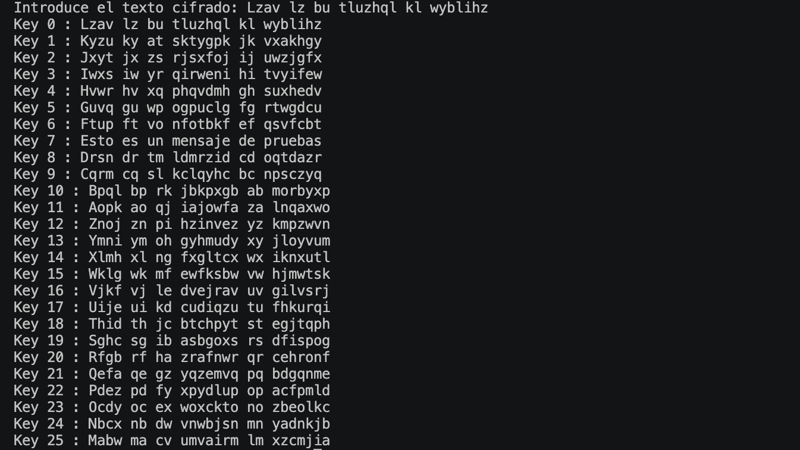

# AP19 - Rompiendo ROT 🔐

## Objetivo

En este ejercicio he creado un programa en Python para romper un texto cifrado con **César/ROT** sin conocer previamente la clave.

El programa prueba automáticamente todas las claves posibles, del `0` al `25`, y muestra el resultado de cada una. Después se identifica cuál de los resultados forma una frase legible.

## Texto cifrado

```text
Lzav lz bu tluzhql kl wyblihz
```

## Resultado

La opción que tiene sentido aparece con la **key 7**:

```text
Esto es un mensaje de pruebas
```

Por tanto:

- **Texto plano:** `Esto es un mensaje de pruebas`
- **Key utilizada:** `7`

## Ejecución

En la siguiente captura se puede ver cómo el programa prueba todas las claves posibles hasta encontrar el resultado correcto:



## Conclusión

El cifrado César es fácil de romper por fuerza bruta porque solo existen 26 posibles desplazamientos.

En este caso, al probar todas las claves, la número `7` devuelve el texto plano correcto.